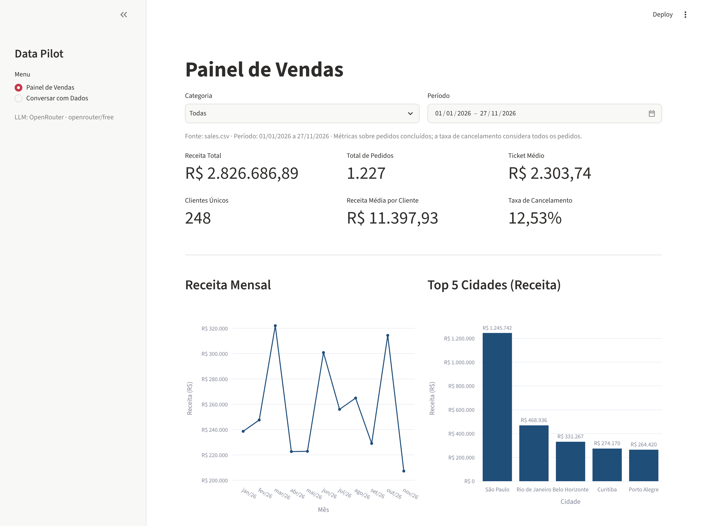
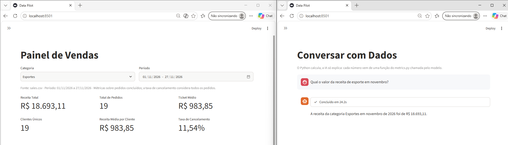
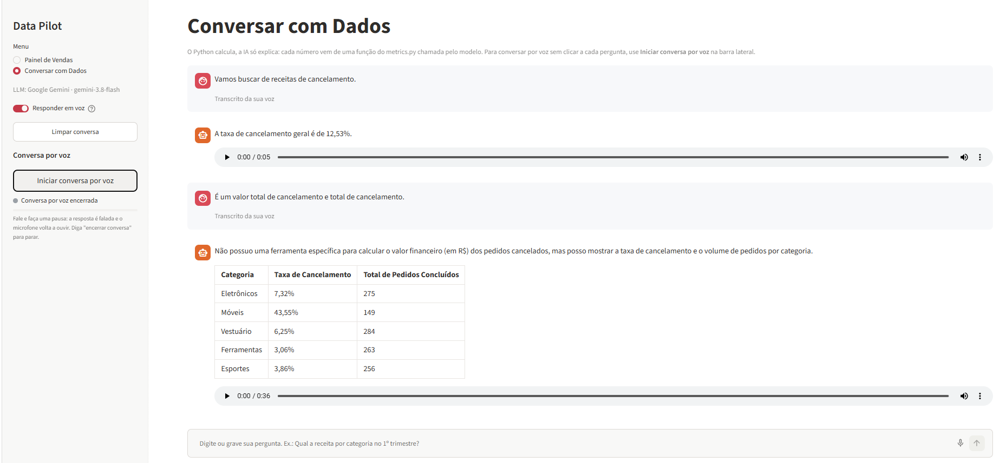

# Data Pilot

Painel de vendas em Python que também conversa: você pergunta em português e um agente de IA responde com as métricas que o código calculou.

**Regra do projeto: o Python calcula, a IA só explica.** O modelo de linguagem nunca faz contas; ele escolhe qual função chamar e explica o resultado. Por isso dá para usar um modelo gratuito sem risco de número inventado.



## O app funcionando

**Os números do chat batem com os do painel.** À esquerda, o painel filtrado em Esportes e novembro/2026; à direita, a mesma pergunta feita no chat. Os dois mostram R$ 18.693,11, calculados pela mesma função de `metrics.py`.



**Pergunta com período e comparação.** "Receita por categoria no 1º trimestre": o modelo converte o período em `data_inicio`/`data_fim` e chama `obter_resumo_por` uma única vez.



Nos prints, o chat usava o Google Gemini, alternativa suportada pelo app (o provedor aparece na barra lateral, em "LLM"). O padrão do projeto é o OpenRouter com `openrouter/free`.

## O que o Data Pilot faz

A aplicação tem dois menus:

- **Painel de Vendas**: cards de receita total, pedidos, ticket médio, clientes únicos, receita média por cliente e taxa de cancelamento; gráfico de receita mensal e das 5 cidades que mais vendem (Plotly); filtros por categoria e período.
- **Conversar com Dados**: chat em linguagem natural, digitado ou por voz. O modelo recebe a lista de ferramentas (nome, descrição e parâmetros), escolhe sozinho qual chamar, o Python executa a função pelo nome e devolve o resultado para o modelo explicar. Tudo sem framework de agentes.

Painel e chat usam as mesmas funções de `metrics.py`, então os números do chat batem com os do painel.

## De onde vêm os dados

`sales.csv`: planilha de vendas de uma loja usada nas aulas do desafio (1.500 pedidos de 01/01/2026 a 27/11/2026, com clientes já anonimizados).

| Coluna | Descrição |
|---|---|
| `id_pedido` | Identificador do pedido |
| `data` | Data do pedido (AAAA-MM-DD) |
| `cliente` | Cliente (anonimizado) |
| `cidade`, `categoria` | Cidade e categoria do produto |
| `quantidade`, `preco_unitario` | Itens e preço unitário |
| `status` | `concluído`, `cancelado` ou `pendente` |

O `data.py` faz a limpeza com pandas: converte datas, padroniza o status (minúsculas, sem espaços), remove espaços extras dos textos, remove duplicados e cria `receita = quantidade × preco_unitario`. O resultado é salvo em `sales_clean.csv` com `;` como separador e vírgula como decimal, e lido do mesmo jeito. Esse arquivo é gerado automaticamente na primeira execução do app (ou com `python data.py`) e não é versionado (está no `.gitignore`).

## Arquitetura

| Camada | Arquivo | Responsabilidade |
|---|---|---|
| Dados | `data.py` | Limpeza do CSV cru e leitura do CSV limpo (com cache) |
| Métricas | `metrics.py` | Uma função por pergunta de negócio, sempre sobre pedidos concluídos |
| Painel | `app.py` | Interface Streamlit: filtros, cards, gráficos e chat |
| Agente | `agent.py` | Lista de ferramentas, chamada ao LLM e execução da função pedida |
| Voz | `voice.py`, `voz_continua.py` | Transcrição local da pergunta (faster-whisper), resposta falada (edge-tts) e conversa contínua no navegador |
| Testes | `tests/` | Testes automatizados de métricas, dados, agente e voz |

Detalhes das regras de negócio e do fluxo do agente: [docs/arquitetura.md](docs/arquitetura.md).

## Como instalar e rodar

Pré-requisitos: Python 3.11 ou superior e uma conta no [OpenRouter](https://openrouter.ai).

```bash
git clone https://github.com/gti-hunter/data-pilot.git
cd data-pilot

python -m venv venv
venv\Scripts\activate            # Windows
# source venv/bin/activate       # Linux/macOS

pip install -r requirements.txt
```

### Configurar o `.env`

Copie o modelo e coloque a sua chave do OpenRouter (crie em https://openrouter.ai/keys):

```bash
copy .env.example .env           # Windows
# cp .env.example .env           # Linux/macOS
```

| Variável | Padrão | Uso |
|---|---|---|
| `LLM_PROVIDER` | `openrouter` | Provedor do LLM: `openrouter` ou `gemini` |
| `OPENROUTER_API_KEY` | | Sua chave do OpenRouter |
| `OPENROUTER_MODEL` | `openrouter/free` | Roteador gratuito que escolhe um modelo com suporte a ferramentas |
| `GEMINI_API_KEY` / `GEMINI_MODEL` | `gemini-3.8-flash` | Alternativa opcional com Google Gemini |
| `GEMINI_REASONING` | `low` | Esforço de raciocínio (`low`, `medium`, `high`); só é enviado a modelos 2.5 ou mais novos |
| `GEMINI_AUTH` | `auto` | `auto`: endpoint compatível com OpenAI (Bearer, aceita chaves `AQ.` e `AIza`) e, se a chave for recusada, API nativa do Gemini (`x-goog-api-key`). Também aceita `bearer` ou `nativo` |
| `GEMINI_FALLBACK_MODELS` | automático | Modelos alternativos, separados por vírgula, usados quando o principal estiver sobrecarregado (HTTP 503/429 ou tempo esgotado). Sem a variável, usa os modelos Flash estáveis liberados para a chave, com os Lite primeiro; vazia, desativa |
| `LLM_TIMEOUT` | `20` | Tempo máximo de cada chamada ao LLM, em segundos |
| `LLM_ORCAMENTO` | `60` | Tempo total, em segundos, para tentar modelos e provedores alternativos |

O `.env` está no `.gitignore`; só o `.env.example` vai para o repositório.

### Rodar

```bash
streamlit run app.py
```

Abra http://localhost:8501. O app precisa ser executado com `streamlit run`, não como script Python comum (`python app.py` apenas mostra esse aviso).

Para testar conexão, chave e modelo antes de abrir o app (mostra o tempo de cada etapa e nunca imprime a chave):

```bash
python agent.py
```

## Conversa por voz

Há dois jeitos de perguntar por voz na aba **Conversar com Dados**:

- **Conversa contínua (mãos livres):** clique uma vez em **Iniciar conversa por voz**, na barra lateral. O microfone fica ativo: faça a pergunta e uma pausa; a pergunta transcrita aparece no chat, a resposta é exibida e falada e o microfone volta a ouvir sozinho para a próxima pergunta. Diga "encerrar conversa" ou clique em **Encerrar conversa por voz** para parar.
- **Pergunta avulsa:** clique no microfone do campo do chat, fale e envie.

```
microfone (navegador, WAV 16 kHz) → faster-whisper local (pt) → agente + ferramentas → resposta em texto → edge-tts (pt-BR) → áudio no navegador
```

- A camada `voice.py` segue o desenho do módulo `speech/` do [OpenJarvis](https://github.com/gti-hunter/OpenJarvis): motores de transcrição e de voz plugáveis, com descoberta automática e preferência pelo processamento local.
- A gravação da voz não sai do computador: a transcrição é local. Para a síntese, só o texto da resposta é enviado ao serviço de voz do Microsoft Edge.
- Na primeira pergunta por voz, o modelo do Whisper (~145 MB no `base`) é baixado do Hugging Face e carregado; depois fica em cache.
- Na conversa contínua, a detecção de início e fim da fala roda no navegador (pausa de ~1,2 s encerra a pergunta) e o microfone fica mudo enquanto a resposta toca, para o agente não ouvir a si mesmo. Ruídos e frases que o Whisper inventa no silêncio são descartados.
- A chave **Responder em voz** na barra lateral liga ou desliga a resposta falada. Para desativar a voz, use `VOICE_ENABLED=false` no `.env`.
- Para testar a voz sem abrir o app: `python voice.py` (gera uma frase falada, salva o MP3 e transcreve de volta).
- O `edge-tts` usa o serviço de leitura em voz alta do Edge, sem chave e sem SLA. Para uso corporativo, a troca natural é o Azure Speech, com as mesmas vozes; basta registrar outro motor em `voice.py`.

## Ferramentas que o modelo pode chamar

Todas aceitam os filtros opcionais `categoria`, `data_inicio` e `data_fim` (AAAA-MM-DD, inclusivos).

| Ferramenta | Responde | Parâmetros extras |
|---|---|---|
| `obter_receita_total` | Receita total em R$ | |
| `obter_total_pedidos` | Quantidade de pedidos | |
| `obter_ticket_medio` | Receita / pedidos | |
| `obter_clientes_unicos` | Clientes distintos | |
| `obter_receita_media_por_cliente` | Receita / clientes únicos | |
| `obter_taxa_cancelamento` | Cancelados / total de pedidos (%) | |
| `obter_top_cidades` | Ranking de cidades por receita | `limite` |
| `obter_receita_mensal` | Receita por mês | |
| `obter_resumo_por` | Todas as métricas por grupo, em uma chamada | `dimensao`: `categoria`, `cidade` ou `mes` |

As métricas consideram apenas pedidos concluídos. A taxa de cancelamento é a exceção: por definição, divide os cancelados pelo total de pedidos de qualquer status.

Exemplos de perguntas:

- Qual a receita total?
- Qual a receita por categoria no primeiro trimestre?
- Quais as 3 cidades que mais venderam em Eletrônicos?
- Qual a receita média por cliente em outubro?
- Qual a taxa de cancelamento de Móveis?

## Melhorias escolhidas

Das quatro ideias de evolução do desafio, todas foram implementadas:

1. **Intenção nova com parâmetro de período**: todas as ferramentas aceitam `data_inicio` e `data_fim`, e o painel ganhou um filtro de período. Perguntas como "receita de Móveis em março" viram uma chamada com datas.
2. **Métrica nova**: receita média por cliente, como card no painel e como ferramenta no chat.
3. **Gráfico novo**: as 5 cidades que mais vendem, também disponível no chat (`obter_top_cidades`).
4. **Portfólio**: este README, prints do painel e do chat (pasta `docs/`) e testes automatizados.
5. **Conversa por voz**: conversa contínua (um clique e o microfone segue ativo) ou pergunta avulsa, com resposta falada, sem mudar o agente nem as métricas.

Além disso:

- `obter_resumo_por` responde comparações ("receita por categoria") em uma única chamada, em vez de uma rodada do modelo por grupo.
- Valores no padrão brasileiro (R$ 1.234,56) nos cards, gráficos e respostas.
- Limite de tempo por chamada, no máximo 4 rodadas por pergunta e mensagens de erro claras para limite de uso, chave inválida e falta de conexão.
- Progresso visível no chat, com o tempo de cada etapa e as ferramentas chamadas.

## Testes

```bash
pip install -r requirements-dev.txt
pytest
```

Os testes conferem as métricas contra resultados calculados à mão, a limpeza e o formato do CSV, a correspondência entre cada ferramenta e a função de `metrics.py`, o fluxo de tool calling com o modelo simulado e, contra um servidor HTTP local, o envio da chave no header, a assinatura do Gemini 3, as mensagens de erro e o fluxo de voz (pergunta gravada → agente → resposta falada) com motores simulados (sem rede e sem gastar cota).

## Limitações

- O modelo gratuito tem limite de uso e a velocidade varia, então uma resposta pode falhar às vezes. Se o modelo estiver sobrecarregado (HTTP 503 "high demand", 429 ou tempo esgotado), o agente refaz a pergunta com outro modelo e, se houver chave dos dois provedores no `.env`, com o outro provedor (até 4 tentativas em 60 s). A troca aparece no progresso e o que funcionou é usado nas perguntas seguintes.
- No plano gratuito do Gemini, os modelos Flash mais novos retornam 503 "high demand" com frequência e têm cota diária baixa. Para uma demonstração estável, configure também a `OPENROUTER_API_KEY` (padrão do desafio) ou ative o faturamento no projeto do Google.
- O `openrouter/free` sorteia entre modelos gratuitos com suporte a ferramentas, e alguns provedores gratuitos podem registrar os prompts. O app envia ao modelo apenas números agregados, nunca linhas da base ou nomes de clientes.
- Ao trocar de modelo, confira no OpenRouter se ele suporta chamada de ferramentas.

## Estrutura

```
data-pilot/
├── app.py               # Interface Streamlit (painel e chat)
├── agent.py             # Ferramentas e chamada ao LLM
├── metrics.py           # Métricas de negócio
├── data.py              # Limpeza e leitura dos dados
├── voice.py             # Transcrição e síntese de voz
├── voz_continua.py      # Conversa contínua por voz (componente do navegador)
├── sales.csv            # Dados de vendas (cru)
├── requirements.txt
├── requirements-dev.txt
├── pytest.ini
├── .env.example         # Modelo do .env (o .env real não é versionado)
├── .gitignore
├── docs/
│   ├── arquitetura.md
│   ├── painel.png
│   ├── painel-e-chat.png
│   └── chat-receita-por-categoria.png
└── tests/
    ├── conftest.py
    ├── test_agent.py
    ├── test_agent_http.py
    ├── test_data.py
    ├── test_metrics.py
    └── test_voice.py
```

Gerados localmente e fora do repositório: `.env`, `sales_clean.csv`, `venv/` e caches (`__pycache__/`, `.pytest_cache/`).
